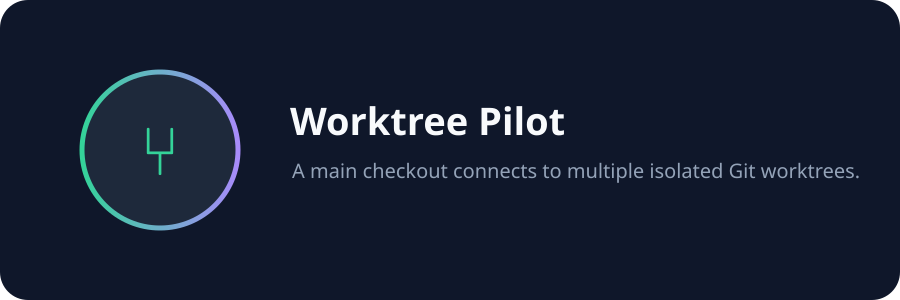

## 🧭 Overview
Worktree Pilot wraps common Git worktree operations in clear commands. It makes prune a dry-run by default and removes only the selected worktree; it never deletes the associated branch.

## ✨ Features
- 🌿 List worktrees with branch, path, and detached state
- ➕ Add a worktree from an existing branch or create a new branch
- 🧹 Remove a chosen worktree without deleting its branch
- 👀 Preview stale-worktree pruning by default
- 🛡️ Require an explicit --apply flag to prune metadata

## 🎬 Demo
~~~bash
git worktree list
python main.py add feature/search ../search --create
python main.py prune
~~~
Pruning is preview-only unless <code>--apply</code> is supplied.

## 🚀 Quick Start
Requires Python 3.10+ and Git installed. Run from inside a Git repository.
~~~bash
python main.py list
python main.py add feature/demo ../demo --create
python main.py remove ../demo
python main.py prune --apply
python -m unittest discover -s tests
~~~

## 🧰 Tech Stack
- 🐍 Python standard library
- 🌿 Git CLI
- 🧪 unittest

## 🗂️ Folder Structure
~~~text
worktree-pilot/
├── assets/overview.svg
├── tests/test_main.py
├── main.py
├── requirements.txt
├── .gitignore
└── README.md
~~~

## 🗺️ Roadmap
- [ ] 🧭 Add interactive selection for removal
- [ ] 📋 Export worktree inventory as JSON
- [ ] 🧪 Add platform-specific integration tests

## 🤝 Contributing
Bug reports and focused pull requests are welcome. Include a reproducible example or a test when changing behavior.

## 📄 License
MIT — see [LICENSE](LICENSE).

